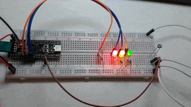

# STM32 ADC LED Level Indicator

Проєкт на STM32, який зчитує значення з аналогового датчика через ADC та відображає рівень сигналу за допомогою чотирьох світлодіодів (White / Green / Yellow / Red). Дані про поточне значення також виводяться в реальному часі через USB CDC (віртуальний COM-порт).

## Демо

## Як це працює

1. Мікроконтролер зчитує значення з аналогового входу через ADC(0-4095).
2. Значення порівнюється з трьома пороговими рівнями (`LOW_VALUE 500`, `MEDIUM_VALUE 2000`, `HIGH_VALUE 3000`).
3. Залежно від рівня загоряється відповідна комбінація світлодіодів:
   - Низький рівень → White
   - Середній рівень → Green
   - Високий рівень → Green + Yellow
   - Максимальний рівень → Green + Yellow + Red
4. Поточне значення ADC надсилається через USB CDC у форматі `Analog value: <value>`, яке можна переглянути в будь-якому серійному моніторі (наприклад, PuTTY, TeraTerm, або Serial Monitor у VS Code).

